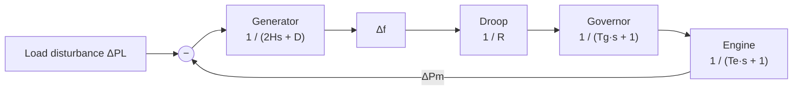
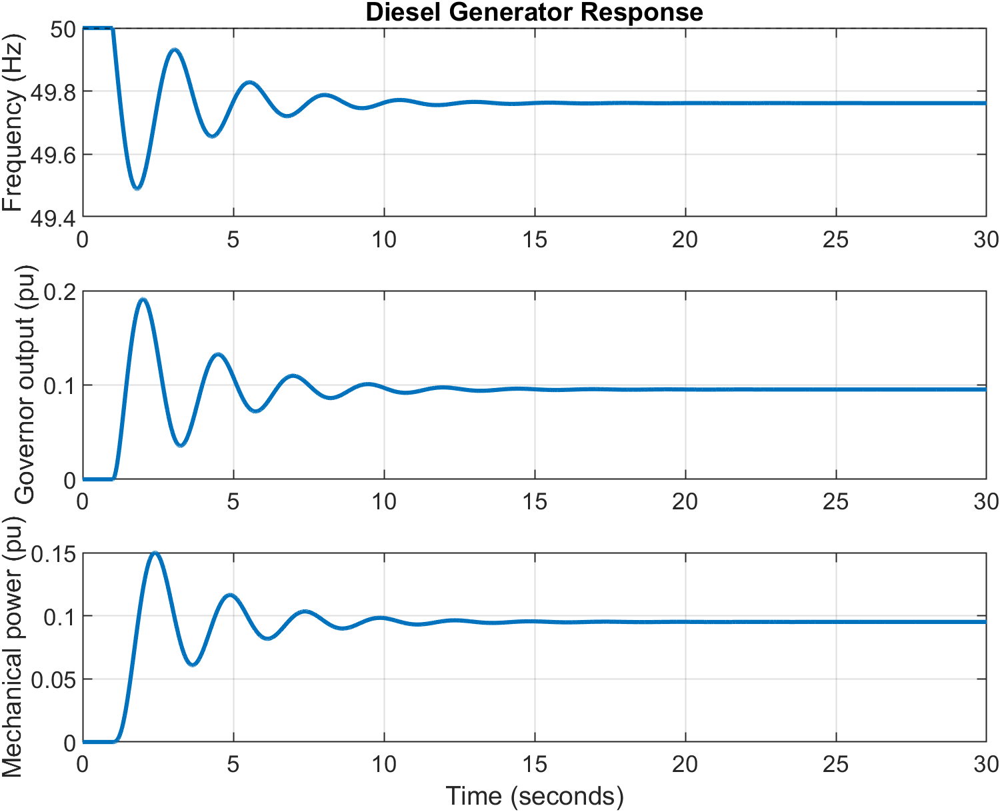
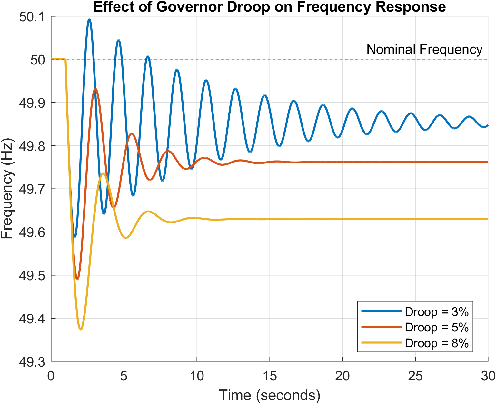
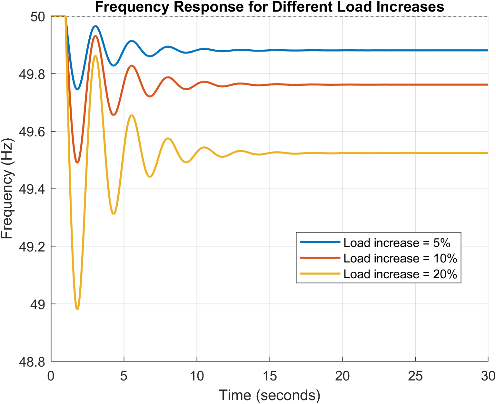

# Diesel Generator Frequency Response (MATLAB)

A MATLAB model of a diesel generator set that studies how frequency changes when a sudden electrical load is connected. The model covers the generator swing equation, governor, diesel engine and droop feedback, and compares the effect of different droop settings and load sizes. It is built with scripts and the Control System Toolbox only, with no Simulink.

> **Disclaimer:** All parameters are illustrative assumptions used to demonstrate system behaviour. They are **not** measured or manufacturer-verified values from any specific generator.

---

## Table of Contents
1. [Objective](#objective)
2. [Working Principle](#working-principle)
3. [Mathematical Model](#mathematical-model)
4. [Parameters and Assumptions](#parameters-and-assumptions)
5. [Repository Structure](#repository-structure)
6. [How to Run](#how-to-run)
7. [Results](#results)
8. [Theory vs Simulation](#theory-vs-simulation)
9. [Key Observations](#key-observations)
10. [Limitations and Future Work](#limitations-and-future-work)
11. [References](#references)

---

## Objective

- Model a diesel generator set using transfer functions.
- Simulate the frequency response to a sudden step load increase.
- Show how the governor and engine respond to the power imbalance.
- Compare governor droop settings (3%, 5%, 8%).
- Compare load disturbances (5%, 10%, 20%).
- Compute performance metrics: minimum frequency, frequency dip, time of minimum, final frequency, settling time and steady-state error.

## Working Principle

In steady state, the engine's mechanical power balances the electrical load. When a load is suddenly connected, electrical demand rises immediately but the engine cannot raise mechanical power instantly. The power imbalance slows the generator, so frequency falls.

The governor senses the frequency deviation and raises the fuel command. The engine then increases mechanical power gradually, reducing the imbalance until the system settles at a new steady state. Because the controller is proportional (droop) only, the final frequency stays slightly below 50 Hz.

## Mathematical Model

**Block diagram**



**Generator (swing equation)**

$$2H\frac{d\Delta f}{dt} + D\,\Delta f = \Delta P_m - \Delta P_L \quad\Rightarrow\quad G_{gen}(s)=\frac{1}{2Hs + D}$$

**Governor**

$$G_g(s)=\frac{1}{T_g s + 1}$$

**Diesel engine**

$$G_e(s)=\frac{1}{T_e s + 1}$$

**Droop controller**

$$\Delta P_{command} = -\frac{\Delta f}{R}$$

**Loop and closed-loop response**

$$G_{control}(s)=\frac{G_g(s)\,G_e(s)}{R}, \qquad G_{freq}(s) = \frac{-G_{gen}(s)}{1 + G_{gen}(s)\,G_{control}(s)}$$

**Steady-state frequency deviation**

$$\Delta f_{ss} = -\frac{\Delta P_L}{D + 1/R}$$

where $\Delta f$ is the per-unit frequency deviation, $H$ the inertia constant, $D$ the load-damping coefficient, $R$ the droop coefficient, and $T_g$, $T_e$ the governor and engine time constants.

## Parameters and Assumptions

| Parameter | Symbol | Value |
|---|---|---|
| Nominal frequency | $f_0$ | 50 Hz |
| Inertia constant | $H$ | 2.5 s |
| Load damping | $D$ | 1.0 |
| Governor time constant | $T_g$ | 0.2 s |
| Engine time constant | $T_e$ | 0.5 s |
| Base droop | $R$ | 0.05 (5%) |
| Base load step | $\Delta P_L$ | 0.10 pu |
| Disturbance time | – | 1 s |
| Simulation duration | – | 30 s |
| Time step | – | 0.01 s |

**Model assumptions:** the generator starts at steady state at 50 Hz, the load is a step input, the system is linear and time-invariant, and the governor and engine are first-order.

**Not modelled:** fuel saturation, actuator rate limits, detailed combustion dynamics, detailed alternator dynamics, protection systems.

## Repository Structure

```
diesel-generator-frequency-response/
├── README.md
├── src/
│   └── diesel_generator_frequency_response.m
├── results/
│   ├── frequency_governor_engine.png
│   ├── droop_comparison.png
│   ├── load_comparison.png
│   └── performance_table.csv
```

## How to Run

**Requirements**
- MATLAB **R2020a or later** (uses `yline` and `exportgraphics`)
- Control System Toolbox
- Simulink is **not** required

**Steps**
1. Clone the repository:
   ```bash
   git clone https://github.com/Aryan-srtfdx/diesel-generator-frequency-response.git
   ```
2. Open MATLAB and set the repository root as the current folder.
3. Run:
   ```matlab
   run('src/diesel_generator_frequency_response.m')
   ```

The script prints metrics to the Command Window and saves figures and a CSV table to `results/`.

## Results

### Frequency, governor and engine response (10% load step, 5% droop)


### Effect of droop setting


### Effect of load size


### Performance table
Full results are in [`results/performance_table.csv`](results/performance_table.csv). Columns: load increase, minimum frequency, frequency dip, final frequency, time of minimum, settling time and steady-state error.

| Load Increase (%) | Min Frequency (Hz) | Frequency Dip (Hz) | Final Frequency (Hz) | Time of Minimum (s) | Settling Time (s) | Steady-State Error (Hz) |
|:---:|:---:|:---:|:---:|:---:|:---:|:---:|
| 5  | 49.745 | 0.255 | 49.881 | 1.81 | 11.04 | 0.119 |
| 10 | 49.490 | 0.510 | 49.762 | 1.81 | 11.04 | 0.238 |
| 20 | 48.980 | 1.020 | 49.524 | 1.81 | 11.04 | 0.476 |

*Time of minimum is measured from the start of the simulation; the load is applied at t = 1 s, so the frequency nadir occurs about 0.81 s after the step. Settling time is measured from the load step.*

**Settling-time definition:** the last time the response lies outside a band of ±2% of the final deviation from nominal, centred on the final value, measured from the load step. The value is approximate and depends on the time step and simulation length.

## Theory vs Simulation

Using $f_{ss} = f_0\left(1 - \dfrac{\Delta P_L}{D + 1/R}\right)$, the expected final frequencies are:

| Case | Expected final frequency |
|---|---|
| 5% load, R = 0.05 | 49.881 Hz |
| 10% load, R = 0.05 | 49.762 Hz |
| 20% load, R = 0.05 | 49.524 Hz |
| 10% load, R = 0.03 | 49.854 Hz |
| 10% load, R = 0.08 | 49.630 Hz |

The script prints the simulated and theoretical final frequency for the base case so the two can be compared directly. With these parameters the response is underdamped, so the **minimum frequency is lower than the final frequency**.

## Key Observations

1. A sudden load increase causes an initial frequency drop.
2. The governor raises its output as frequency falls.
3. Mechanical power rises gradually because of the engine time constant.
4. Frequency settles to a new value below 50 Hz.
5. Lower droop (smaller R) gives a smaller steady-state frequency error.
6. In this linear model, frequency deviations scale proportionally with load size.
7. Droop control alone does not restore 50 Hz. Secondary (integral) frequency control would be needed.

## Limitations and Future Work

- Simplified linear model with first-order governor and engine.
- Add fuel limits and actuator rate limits.
- Use more realistic engine dynamics (e.g. transport delay).
- Add secondary frequency restoration (integral control).
- Extend to parallel generators with droop-based load sharing.
- Validate against manufacturer data or published experiments.

## References

- P. Kundur, *Power System Stability and Control*, McGraw-Hill, 1994.
- H. Saadat, *Power System Analysis*, McGraw-Hill.

## Author

**Aryan Kose** – [GitHub: Aryan-srtfdx](https://github.com/Aryan-srtfdx)
